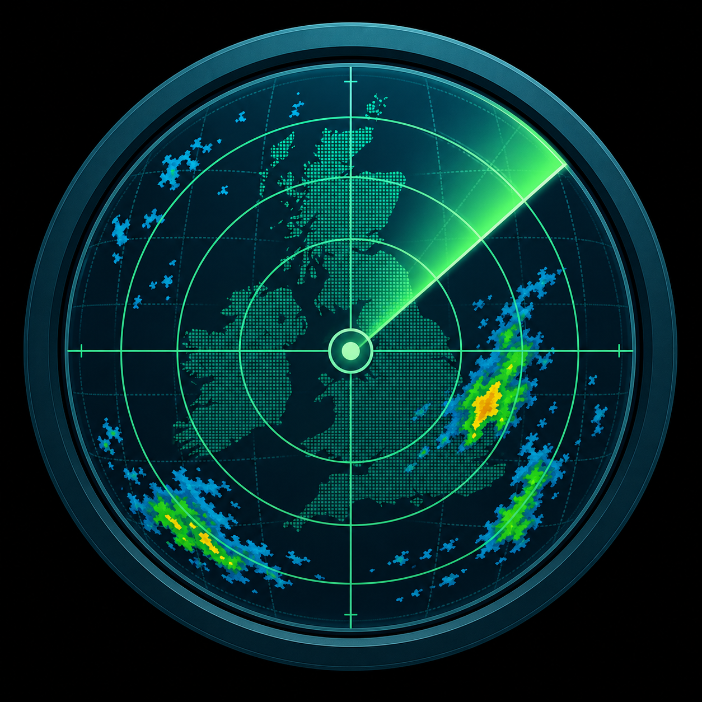

<p align="center">
  
</p>

# UK WSR Visualizer

Find, view, compare and export UK weather-radar scans. The app reads small
catalogues, downloads the scan you choose and keeps its source and display
settings with your exports.

Desktop apps run on macOS, Windows and Linux. The native iPhone/iPad app and
Android app live here too. This is beta research software; check the build notes
for tested platforms and distribution status.

[User guide](https://rrniii.github.io/uk-wsr-visualizer/) ·
[Beta releases](https://github.com/rrniii/uk-wsr-visualizer/releases) ·
[Release notes](docs/release_notes.md)

## Use the app

1. Install the package for your platform and check its SHA-256 checksum.
2. Choose a radar and date, then a pulse, time, variable and elevation.
3. View the PPI, step through time or compare scans.
4. Export an image, animation or project with its provenance.

Start with the [installation guide](docs/user_guide/installation.md) and
[Castor Bay example](docs/user_guide/quickstart.md). For mobile builds, see
[iPhone/iPad](ios/README.md) and [Android](android/README.md).

The desktop packages include their Python runtime. The mobile apps decode HDF5
on the device. You do not need a JASMIN account to use the public catalogue.

## Data and interpretation

CEDA is the authoritative archive. JASMIN prepares the public per-volume PVOL
files and catalogues used by this app. Catalogue dates show what is published;
a missing date does not prove the original data are absent.

The app leaves source files unchanged. Optional cleanup is a viewing choice:
compare it with the decoded baseline before interpreting weak weather,
biological echoes or clutter. Exports record the source, UTC time, pulse,
variable, sweep, display settings, cleanup settings and software build.

This is a first-look tool. Use Py-ART, wradlib, vol2bird, bioRad or your usual
analysis workflow for further work.

## Run from source

Python 3.11+ is required. Source development also needs collaborator access to
the separate `uk-wsr-qc` repository. Packaged users do not need that access.

```bash
git clone git@github.com:rrniii/uk-wsr-qc.git
git clone git@github.com:rrniii/uk-wsr-visualizer.git
git -C uk-wsr-qc checkout 10f05f615c8ea9c5924fac7d4fa00a6d8fb21cae
cd uk-wsr-visualizer
python -m venv .venv
. .venv/bin/activate
python -m pip install -e ../uk-wsr-qc
python -m pip install -e ".[dev,export,video]"
uk-wsr-visualizer api --host 127.0.0.1 --port 8000
```

Open `http://127.0.0.1:8000`.

## Develop and cite

The [developer guide](docs/developer_guide/index.md) covers the code, tests and
packaging. The [release checklist](docs/release_checklist.md) separates a built
artifact from a verified download or store release. Bulk processing and archive
publication have their own [operations guide](docs/operations/index.md).

Keep scientific QC research in the versioned `uk-wsr-qc` project. App changes
must preserve source data and the shared selection, project and export formats.

See [CITATION.md](CITATION.md) for software, source-data and JASMIN attribution.
Use `uk-wsr-visualizer-citation --json` to inspect the current metadata. Pending
DOIs remain marked until assigned.

BSD-3-Clause licensed. This independent project is not an official data service.
